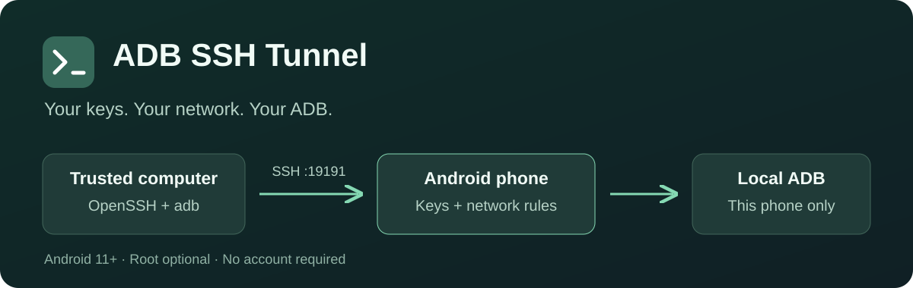

# ADB SSH Tunnel

**English** · [Русский](README.ru.md)



### Your Android ADB, through your own SSH keys.

Connect a trusted computer to your phone's ADB when a USB cable is inconvenient.
Choose the networks that can accept connections, import your public SSH key, and
forward one local port. The tunnel reaches only this phone's local ADB.

**[Download APK](https://github.com/krotname/AdbSshTunnel/releases/latest)** ·
[Setup guide](docs/USAGE.md) ·
[Ask a question](https://github.com/krotname/AdbSshTunnel/issues)

**Android 11+** · **arm64-v8a / x86_64** · **Version 2.0.1** · **GPL-3.0**

## What you get

| Feature | How it helps |
|---|---|
| Wireless Debugging without root | Pair with Android's ADB; the app discovers its current local connect port. |
| Root ADB mode | Use the protected native root controller on a supported rooted device. |
| Key-only SSH | Keep the private key on your computer; import only its OpenSSH public key. |
| Per-network access | Separate Wi-Fi SSID and mobile operator allowlists and blocklists; blocked entries win. |
| Status at a glance | Tunnel switch, connection details, diagnostics and a Quick Settings tile. |
| English and Russian | Follow the system language or choose a language in the app. |

No account, advertising, in-app purchases or analytics SDKs. Settings, network
rules and imported public keys stay on the device. See the [privacy policy](docs/PRIVACY.md).

## Connect without root

You need an Android 11+ phone, a computer with `adb` and an OpenSSH client,
and a network path from the computer to the phone. Start on trusted Wi-Fi.

1. Install the APK from [GitHub Releases](https://github.com/krotname/AdbSshTunnel/releases/latest).
2. Enable **Developer options → Wireless debugging** on the phone. Use the pairing address and port shown by Android:

   ```sh
   adb pair PHONE_IP:PAIR_PORT
   ```

3. Import the computer's **public** SSH key in the app, allow the current Wi-Fi network, and enable the tunnel. Keep the private key on the computer.
4. Verify the phone's SSH host key through a trusted connection before the first SSH connection. Open the tunnel in one terminal:

   ```sh
   ssh -N -L 15555:127.0.0.1:5555 -p 19191 -i YOUR_KEY USER@PHONE_IP
   ```

5. Leave that terminal open. Connect ADB in another terminal:

   ```sh
   adb connect 127.0.0.1:15555
   adb devices
   ```

Replace `PHONE_IP`, `PAIR_PORT`, `YOUR_KEY` and `USER` with your connection values.
The SSH forwarding target stays **`127.0.0.1:5555`**: the app maps it to Android's
current local ADB port. The pairing port is separate. When Android changes the
connect port, reopen SSH using the same command.

## Choose the distribution

| APK | Wireless Debugging recovery |
|---|---|
| Full APK from GitHub | Optional **Keep Wireless Debugging enabled** after a one-time permission grant from a trusted ADB computer. |
| RuStore variant | Turn Wireless Debugging back on manually when Android disables it; no keep-enabled permission or switch. |

Both variants retain SSH keys, network rules, pairing, port discovery and Root ADB.
They share the package and signing key, so switching variants preserves app data.
See the [recovery setup and its limits](docs/USAGE.md#without-root) before enabling it.

## Know the boundaries

- New installations start with empty network allowlists. Explicitly allow a network before expecting an SSH listener.
- Android needs location permission and its location toggle to identify a Wi-Fi SSID; background location is needed for Wi-Fi access after reboot. The app does not request GPS coordinates. Mobile operator identification needs phone-state permission.
- Android may disable Wireless Debugging after reboot or a network change and may require network confirmation or pairing again.
- This is an ADB-only tunnel. Shell, PTY, file transfer, SSH agent/X11 and reverse forwarding are disabled; other forwarding targets are rejected.
- Mobile access needs a reachable route to the phone. Carrier NAT can prevent incoming connections; the app does not provide a relay or configure a VPN.

## Guides, support and source

- [Usage, root mode and build instructions](docs/USAGE.md)
- [Network policy behavior](docs/network-policy-acceptance.md)
- [Root controller](docs/root-controller-acceptance.md)
- [Report a bug or request a feature](https://github.com/krotname/AdbSshTunnel/issues)
- [4PDA discussion](https://4pda.to/forum/index.php?showtopic=1128500)
- [Privacy policy](docs/PRIVACY.md) · [License](LICENSE)

Application code is GPL-3.0. Native SSH code comes from
[Sshd4a](https://github.com/tfonteyn/Sshd4a/tree/897f9064a7279bff89538ec87729c43888f3b83d);
the pinned source retains its Dropbear, libtommath and libtomcrypt notices.
