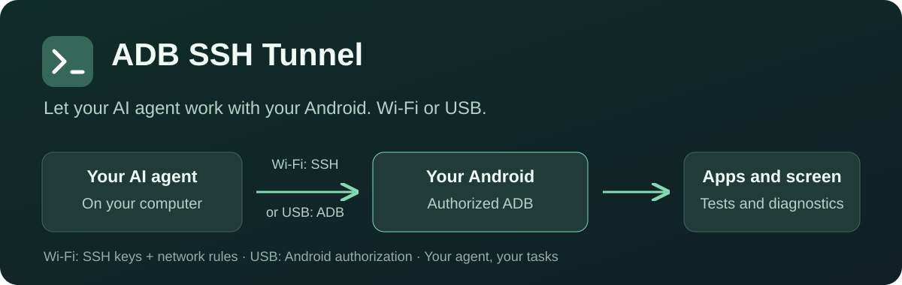

# ADB SSH Tunnel

**English** · [Русский](README.ru.md)

### Let your AI agent work with your Android — over Wi-Fi or USB.

Give an AI agent on your trusted computer the connection it needs to carry out
your Android tasks: install and test apps, inspect the screen, run ADB commands
and collect diagnostics. Once you set up and authorize access, the agent can
work autonomously without you relaying each command.

Use encrypted, key-only SSH over Wi-Fi, or Android's authorized USB debugging
connection over a cable. You choose the trusted computer, SSH keys and networks
that can reach the tunnel.

**[Download APK](https://github.com/krotname/AdbSshTunnel/releases/latest)** ·
[Setup guide](docs/USAGE.md) ·
[Ask a question](https://github.com/krotname/AdbSshTunnel/issues)

**Android 10+** · **armeabi-v7a / arm64-v8a / x86_64** · **Version 2.4.0** · **GPL-3.0**



## Set the task. Let the agent handle the commands.

For example: “Install the test build, open the app, take a screenshot and collect
the error log.” Use your existing AI agent and Android automation tools on the
computer; ADB SSH Tunnel provides the connection to the phone.

| Connection | How the agent reaches your Android |
|---|---|
| Wi-Fi | ADB SSH Tunnel forwards this phone's local ADB through encrypted SSH, with your imported public key and network rules. |
| USB cable | The agent uses Android's built-in USB debugging after you approve the computer on the phone. SSH is not required for this path. |

On compatible rooted phones, the app can also keep USB debugging enabled and
preserve approved ADB keys. New computers still require Android authorization.

## Access stays under your control

- **Your keys:** SSH accepts imported public keys only. Your private key stays on the computer; verify the phone's SSH host key before connecting.
- **Your networks:** choose allowed Wi-Fi networks and block unwanted ones. You can stop the SSH tunnel from the app.
- **One tunnel target:** SSH forwarding reaches only this phone's local ADB; SSH shell sessions and other forwarding targets are disabled.

ADB is powerful: an authorized agent can run shell commands, install apps and
access data available to ADB. Give access only to a trusted computer and agent,
and set the agent's action permissions accordingly. Initial Android authorization,
pairing and any later confirmation prompts still need the owner's involvement.

## What you get

| Feature | How it helps |
|---|---|
| Wireless Debugging without root | Pair with Android's ADB; the app discovers its current local connect port. |
| Android 10 without root | Activate ADB once over USB after each reboot; the app tunnels the RSA-authenticated local ADB endpoint. |
| Root ADB mode | Use the protected native root controller on a supported rooted device. |
| Keep USB debugging (root) | Restore USB ADB and keep approved keys from expiring; new computers still need Android RSA confirmation. |
| Key-only SSH | Keep the private key on your computer; import only its OpenSSH public key. |
| Per-network access | Separate Wi-Fi SSID and mobile operator allowlists and blocklists; blocked entries win. |
| Status at a glance | Tunnel switch, connection details, diagnostics and a Quick Settings tile. |
| English and Russian | Follow the system language or choose a language in the app. |

No account, advertising, in-app purchases or analytics SDKs. Settings, network
rules and imported public keys stay on the device. See the [privacy policy](docs/PRIVACY.md).

## Connect without root

On Android 10 without root, first enable USB debugging, connect the phone to a
trusted computer, approve its RSA key and run `adb -d tcpip 5555`. Select
**ADB after USB activation (Android 10)** in the app. Repeat USB activation after
each phone reboot. This opens Android's ADB port 5555 on the network as well;
use only a trusted network. Without root the app cannot firewall that port.
Run `adb usb` from the connected computer when finished to close network ADB.
SSH keys and Android RSA authorization remain required; TLS pairing is available
only on Android 11+. The app refuses a legacy ADB daemon that accepts connections
without RSA authentication.

You need an Android 10+ phone, a computer with `adb` and an OpenSSH client,
and a network path from the computer to the phone. Start on trusted Wi-Fi.

1. Install the APK from [GitHub Releases](https://github.com/krotname/AdbSshTunnel/releases/latest).
2. On Android 11+, enable **Developer options → Wireless debugging** on the phone. Use the pairing address and port shown by Android:

   ```sh
   adb pair PHONE_IP:PAIR_PORT
   ```

3. Import the computer's **public** SSH key in the app, allow the current Wi-Fi network, and enable the tunnel. Keep the private key on the computer.
4. Verify the phone's SSH host key through a trusted connection before the first SSH connection. Open the tunnel in one terminal:

   ```sh
   ssh -N -L 15555:127.0.0.1:5555 -p 19191 -i YOUR_KEY USER@PHONE_IP
   ```

5. Leave that terminal open. Connect ADB in another terminal:

   ```sh
   adb connect 127.0.0.1:15555
   adb devices
   ```

Replace `PHONE_IP`, `PAIR_PORT`, `YOUR_KEY` and `USER` with your connection values.
The share icon at the top right of the home screen sends this phone's connection
configuration through Android's share menu: allowed network addresses, SSH/ADB
commands, the public server key and setup instructions. It includes no private
keys or passwords. Verify the server fingerprint through a trusted channel.
The SSH forwarding target stays **`127.0.0.1:5555`**: the app maps it to Android's
current local ADB port. The pairing port is separate. When Android changes the
connect port, reopen SSH using the same command.

## Choose the distribution

| APK | Wireless Debugging recovery |
|---|---|
| Full APK from GitHub | Optional **Keep Wireless Debugging enabled** after a one-time permission grant from a trusted ADB computer. |
| RuStore variant | Turn Wireless Debugging back on manually when Android disables it; no keep-enabled permission or switch. |

Both variants retain SSH keys, network rules, pairing, port discovery and Root ADB.
They share the package and signing key, so switching variants preserves app data.
See the [recovery setup and its limits](docs/USAGE.md#without-root) before enabling it.

## Know the boundaries

- New installations start with empty network allowlists. Explicitly allow a network before expecting an SSH listener.
- Android needs location permission and its location toggle to identify a Wi-Fi SSID; background location is needed for Wi-Fi access after reboot. The app does not request GPS coordinates. Mobile operator identification needs phone-state permission.
- Android may disable Wireless Debugging after reboot or a network change and may require network confirmation or pairing again.
- This is an ADB-only SSH tunnel. SSH shell, PTY, SSH file transfer, SSH agent/X11 and reverse forwarding are disabled; other forwarding targets are rejected. Authorized ADB commands, including `adb shell`, remain available.
- Mobile access needs a reachable route to the phone. Carrier NAT can prevent incoming connections; the app does not provide a relay or configure a VPN.

## Guides, support and source

- [Development: OpenSpec contract and mandatory CI checks](openspec/README.md)
- [Usage, root mode and build instructions](docs/USAGE.md)
- [Network policy behavior](docs/network-policy-acceptance.md)
- [Root controller](docs/root-controller-acceptance.md)
- [Report a bug or request a feature](https://github.com/krotname/AdbSshTunnel/issues)
- [4PDA discussion](https://4pda.to/forum/index.php?showtopic=1128500)
- [Privacy policy](docs/PRIVACY.md) · [License](LICENSE)

**Linux phone or desktop?** The [Linux edition](linux/README.md) uses a native,
adaptive GTK interface and a restricted tunnel to the Linux SDK ADB server.
It is a separate package from the Android APK; see its setup and limitations.
It is also available as a strictly confined Snap: `snap install adb-ssh-tunnel`
([Snap Store page](https://snapcraft.io/adb-ssh-tunnel)).

Application code is GPL-3.0. Native SSH code comes from
[Sshd4a](https://github.com/tfonteyn/Sshd4a/tree/897f9064a7279bff89538ec87729c43888f3b83d);
the pinned source retains its Dropbear, libtommath and libtomcrypt notices.
