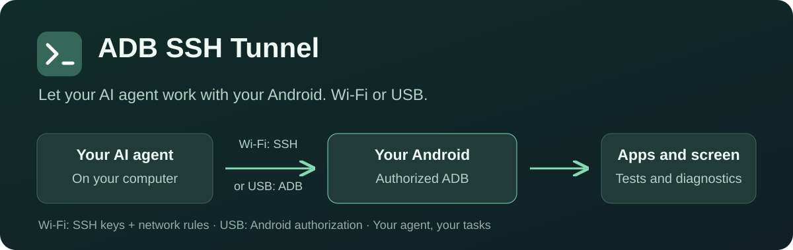

# ADB SSH Tunnel

[English](README.md) · **Русский**

### Дайте ИИ-агенту доступ к вашему Android — по Wi-Fi и USB.

Поручите агенту на доверенном компьютере установить и проверить приложение,
посмотреть экран телефона, выполнить команды ADB или собрать диагностику.
После первоначальной настройки и разрешения доступа агент сможет работать
автономно: вам не придётся вручную передавать каждую команду.

По Wi-Fi соединение защищено шифрованием SSH и входом по ключу; по кабелю
используется штатная USB-отладка Android с подтверждением компьютера.
Вы выбираете доверенный компьютер, SSH-ключи и сети, доступные для туннеля.

**[Скачать APK](https://github.com/krotname/AdbSshTunnel/releases/latest)** ·
[Подробная инструкция](docs/USAGE.md) ·
[Задать вопрос](https://github.com/krotname/AdbSshTunnel/issues)

**Android 10+** · **armeabi-v7a / arm64-v8a / x86_64** · **Версия 2.4.0** · **GPL-3.0**



## Вы ставите задачу — агент выполняет команды

Например: «Установи тестовую сборку, открой приложение, сделай скриншот
и собери журнал ошибок». Используйте своего ИИ-агента и инструменты автоматизации
Android на компьютере; ADB SSH Tunnel обеспечивает связь с телефоном.

| Подключение | Как агент получает доступ к Android |
|---|---|
| Wi-Fi | Приложение передаёт локальный ADB телефона через зашифрованный SSH-туннель с вашим открытым ключом и сетевыми правилами. |
| Кабель USB | Агент использует штатную USB-отладку после вашего подтверждения компьютера на телефоне. SSH для этого пути не требуется. |

На совместимых устройствах с root приложение также может удерживать USB-отладку
и сохранять одобренные ключи ADB. Новый компьютер всё равно требует подтверждения Android.

## Доступ остаётся под вашим контролем

- **Ваши ключи:** SSH принимает только добавленные открытые ключи. Закрытый ключ остаётся на компьютере; перед подключением проверьте SSH-ключ сервера телефона.
- **Ваши сети:** разрешайте выбранные Wi-Fi сети и запрещайте нежелательные. SSH-туннель можно остановить в приложении.
- **Одна цель туннеля:** проброс SSH ведёт только к локальному ADB этого телефона; командная оболочка SSH и другие цели проброса отключены.

ADB даёт широкие возможности: авторизованный агент может выполнять команды
оболочки, устанавливать приложения и читать доступные ADB данные. Разрешайте
доступ только доверенному компьютеру и агенту, задайте агенту допустимые действия.
Первоначальное разрешение Android, сопряжение и последующие запросы подтверждения
требуют участия владельца.

## Возможности

| Возможность | Что даёт |
|---|---|
| Беспроводная отладка без root | Сопряжение со штатным ADB Android и автоматическое определение его текущего локального порта. |
| Android 10 без root | Однократное включение ADB через USB после каждой перезагрузки; туннель проверяет RSA-авторизацию локального ADB. |
| Режим Root ADB | Защищённый нативный контроллер на совместимом устройстве с root. |
| Удержание USB-отладки с root | Восстановление USB ADB и сохранение одобренных ключей; новые компьютеры требуют подтверждения RSA в Android. |
| SSH только по ключам | Закрытый ключ остаётся на компьютере; в приложение добавляется открытый ключ OpenSSH. |
| Доступ по сетям | Отдельные разрешающие и запрещающие списки Wi-Fi SSID и мобильных операторов; запрет важнее разрешения. |
| Состояние на одном экране | Переключатель туннеля, параметры подключения, диагностика и плитка быстрых настроек. |
| Русский и английский | Язык системы или выбранный вручную язык приложения. |

Без аккаунта, рекламы, встроенных покупок и аналитических SDK. Настройки, сетевые
правила и открытые ключи хранятся на устройстве. [Политика конфиденциальности](docs/PRIVACY.md).

## Подключение без root

На Android 10 без root сначала включите USB-отладку, подключите телефон к
доверенному компьютеру, подтвердите его RSA-ключ и выполните `adb -d tcpip 5555`.
В приложении выберите **ADB после USB-активации (Android 10)**. Повторяйте активацию
после каждой перезагрузки телефона. При этом порт ADB 5555 открывается и в сети:
используйте только доверенную сеть. Без root приложение не может закрыть этот порт
сетевым экраном. По окончании выполните `adb usb` с подключённого компьютера.
SSH-ключи и RSA-авторизация Android обязательны; сопряжение TLS доступно с Android 11.
Приложение отклоняет старый ADB, если тот принимает подключения без RSA-авторизации.

Нужны телефон с Android 10+, компьютер с `adb` и клиентом OpenSSH, а также сетевой
маршрут от компьютера к телефону. Первое подключение выполняйте в доверенной Wi-Fi сети.

1. Установите APK из [GitHub Releases](https://github.com/krotname/AdbSshTunnel/releases/latest).
2. На Android 11+ включите на телефоне **Для разработчиков → Беспроводная отладка**. Используйте адрес и порт сопряжения, показанные Android:

   ```sh
   adb pair PHONE_IP:PAIR_PORT
   ```

3. Добавьте в приложение **открытый** SSH-ключ компьютера, разрешите текущую Wi-Fi сеть и включите туннель. Закрытый ключ оставьте на компьютере.
4. До первого SSH-подключения проверьте ключ сервера телефона через доверенное соединение. В одном терминале откройте туннель:

   ```sh
   ssh -N -L 15555:127.0.0.1:5555 -p 19191 -i YOUR_KEY USER@PHONE_IP
   ```

5. Оставьте этот терминал открытым. В другом терминале подключите ADB:

   ```sh
   adb connect 127.0.0.1:15555
   adb devices
   ```

Замените `PHONE_IP`, `PAIR_PORT`, `YOUR_KEY` и `USER` своими параметрами подключения.
Цель проброса SSH всегда **`127.0.0.1:5555`**: приложение направляет её на текущий
локальный порт ADB Android. Порт сопряжения используется отдельно. При изменении
порта подключения Android откройте SSH заново той же командой.

## Варианты APK

| APK | Восстановление беспроводной отладки |
|---|---|
| Полный APK с GitHub | Необязательное удержание отладки после однократной выдачи разрешения с доверенного ADB-компьютера. |
| Вариант RuStore | Если Android отключит отладку, включите её вручную; разрешение и переключатель удержания отсутствуют. |

В обоих вариантах доступны SSH-ключи, сетевые правила, сопряжение, определение
порта и Root ADB. Package и ключ подписи общие: при смене варианта данные приложения
сохраняются. Перед включением удержания прочитайте [настройку и ограничения](docs/USAGE.md#without-root).

## Условия работы

- При новой установке списки разрешённых сетей пусты. Сначала явно разрешите сеть, чтобы SSH мог принимать подключения.
- Для определения Wi-Fi SSID Android требует разрешение геолокации и включённую геолокацию; для доступа по Wi-Fi после перезагрузки нужно фоновое разрешение. GPS-координаты приложение не запрашивает. Для определения мобильного оператора нужно разрешение состояния телефона.
- После перезагрузки или смены сети Android может отключить беспроводную отладку и снова запросить подтверждение сети либо сопряжение.
- Через SSH доступен только проброс ADB. Командная оболочка SSH, PTY, передача файлов через SSH, проброс SSH agent/X11 и обратный проброс отключены; другие цели проброса отклоняются. Авторизованные команды ADB, включая `adb shell`, доступны.
- Для мобильного доступа нужен доступный маршрут к телефону. NAT оператора может блокировать входящие подключения; приложение не предоставляет ретранслятор и не настраивает VPN.

## Документация и обратная связь

- [Разработка: OpenSpec и обязательные проверки CI](openspec/README.md)
- [Подробная инструкция, root-режим и сборка](docs/USAGE.md)
- [Работа сетевых правил](docs/network-policy-acceptance.md)
- [Контроллер Root ADB](docs/root-controller-acceptance.md)
- [Сообщить об ошибке или предложить функцию](https://github.com/krotname/AdbSshTunnel/issues)
- [Обсуждение на 4PDA](https://4pda.to/forum/index.php?showtopic=1128500)
- [Политика конфиденциальности](docs/PRIVACY.md) · [Лицензия](LICENSE)

**Linux на телефоне или компьютере:** [Linux-версия](linux/README.md) — отдельный
пакет с адаптивным интерфейсом GTK и ограниченным туннелем к локальному серверу
ADB. Это сервер SDK в Linux, а не Android adbd; команды и ограничения отличаются.
Также доступен строго изолированный Snap: `snap install adb-ssh-tunnel`
([страница в Snap Store](https://snapcraft.io/adb-ssh-tunnel)).

Код приложения распространяется по GPL-3.0. Нативная SSH-часть основана на
[Sshd4a](https://github.com/tfonteyn/Sshd4a/tree/897f9064a7279bff89538ec87729c43888f3b83d);
уведомления Dropbear, libtommath и libtomcrypt сохранены в закреплённом исходном коде.
